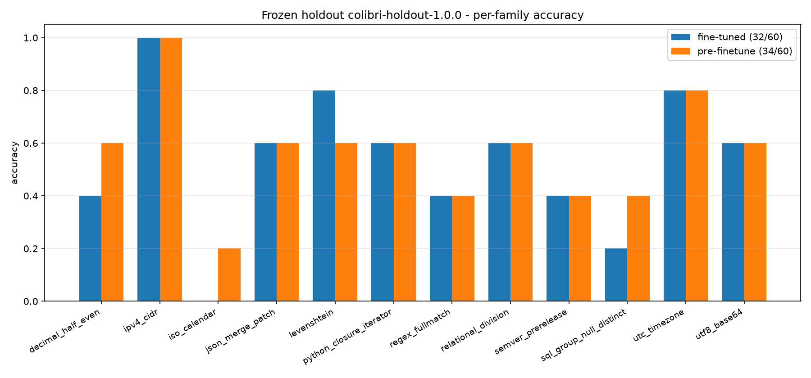

# Fennec Fine-tune

Streamed LoRA fine-tuning of large MoE models (Qwen3.6-35B-A3B) on a small GPU,
built on **[AirLLM](https://github.com/lyogavin/airllm)**. The frozen bf16 base is
streamed one decoder layer at a time from disk shards; LoRA A/B + AdamW live on
CUDA and autograd hidden states stay on CPU. Verified on an 8 GB RTX 4060: a full
forward+backward through 40 MoE layers peaks at **~1.9 GB VRAM**.

## Features

- Streamed LoRA training through AirLLM on an 8 GB GPU (~2 GB peak VRAM).
- Execution-verified SFT data generation: reference solutions are actually run against tests.
- Shard-wise LoRA merge, int4 conversion and before/after evaluation.
- Frozen 60-case holdout with a per-case zero-regression promotion policy.
- Reproducible evidence: verdict JSON, run logs and comparison graphs in `results/`.

## Pipeline

1. **Download** the bf16 source — `scripts/download_qwen36_bf16.py`
   (`Qwen/Qwen3.6-35B-A3B` → `~/fennec-models`, cache in `~/.cache/fennec`).
2. **Build SFT data** — `scripts/make_sft_data.py` author coding tasks and
   *executes* each reference solution against unit tests, keeping only verified
   correct examples → `data/sft_coding_verified.jsonl`.
3. **Train** — `scripts/airllm_train_qwen36.py` (AirLLM `AirLLMLoRA`). Run
   `--smoke` first to confirm compatibility + VRAM, then a full run. Attention and
   shared-expert linears train; packed MoE experts stay frozen.
4. **Merge** — `scripts/merge_lora_qwen36.py` applies `W += (alpha/r)·(B@A)`
   shard-by-shard into a copy of the bf16 base.
5. **Convert + verify** — `scripts/run_finetune_eval.py` chains merge → convert
   (`--ebits 4 --gs 64`) → candidate serve → execution-verified before/after
   benchmarks (hard + base suites, greedy, no-think) → comparison graph →
   `results/finetune_verdict.json`. The original container is never modified;
   promote the candidate only with zero regressions. Requires the engine
   checkout (`~/Colibri`) for `bench_best_model.py` and `c/tools/convert_qwen36.py`.
6. **Graph** — `scripts/make_finetune_graph.py` renders passes + training loss
   into `results/bench_finetune_comparison.png` and prints the winner.

### Frozen holdout (60 cases)

`scripts/bench_holdout.py` is a stdlib-only, pinned benchmark across 12
structured-reasoning families (JSON merge patch, semver, CIDR, ISO calendar,
decimal rounding, ...) with exact JSON scoring. It never executes model output,
starts servers, or deletes models. Validate it offline with
`--manifest-only --out manifest.json`, run it against a serving engine with
`--model <id> --model-path <dir> --out report.json`, and compare two completed
reports with `--compare original.json candidate.json`. The comparison policy is
quality-first: a candidate is chosen only with at least one gain and zero
regressions; ties keep the incumbent.

```bash
FENNEC_API_KEY=local python scripts/bench_holdout.py \
  --model qwen36-35b --model-path ~/fennec-models/qwen36-35b \
  --out results/holdout_run_qwen36-35b.json
```

**Result (2026-11-10):** fine-tuned `qwen36-35b` scored **32/60**, base
`qwen36-35b-pre-finetune` scored **34/60**. The base gains 4 cases but
regresses 2 (`levenshtein.01`, `relational_division.03`), so the
zero-regression policy keeps the fine-tuned model. Evidence:
`results/holdout_run_qwen36-35b_finetuned.json`,
`results/holdout_run_qwen36-35b-pre.json`,
`results/holdout_compare_finetuned_vs_pre.txt`, `results/holdout_verdict.json`.
The suite was not used for training and remains a holdout.



## Usage

```bash
python scripts/make_sft_data.py
python scripts/airllm_train_qwen36.py --smoke          # feasibility gate
python scripts/airllm_train_qwen36.py --epochs 2 --lr 5e-5 --rank 16
python scripts/merge_lora_qwen36.py --adapter ~/fennec-models/qwen36-lora-adapter.pt
python scripts/run_finetune_eval.py    # merge+convert+bench+graph in one chain
```

## Credits

- **[AirLLM](https://github.com/lyogavin/airllm)** — layer-streamed inference and
  the streamed LoRA trainer this pipeline uses.
- **[JustVugg/colibri](https://github.com/JustVugg/colibri)** — the base idea of the
  inference engine that serves the converted container.

Part of the [Fennec suite](https://github.com/Liso7150/fennec-environment-setup).

## Engine vs AirLLM inference benchmark

`scripts/bench_engine_vs_airllm.py` compares the Colibri engine with AirLLM-only
inference on the same machine, prompts and token budget, and writes
`results/engine_vs_airllm.{json,md}`.

```bash
python scripts/bench_engine_vs_airllm.py --backend both --tokens 24
```

Result on 2026-11-10 (RTX 4060 8 GB, 22 threads, `qwen36-35b`): the engine served
every prompt — median **4.9 tok/s**, time-to-first-token **0.86 s**, 41 s engine
startup. AirLLM 4.0.0 alone could not load that model at all: its generic layer
splitter assumes `model.layers` while `Qwen3_5MoeForConditionalGeneration` nests
the blocks under `model.language_model.layers`
(`ValueError: invalid literal for int() with base 10: 'layers'`), and the
installed torch build is CPU-only. Verdict: the Colibri engine stays the
inference path; AirLLM remains the fine-tuning layer.
